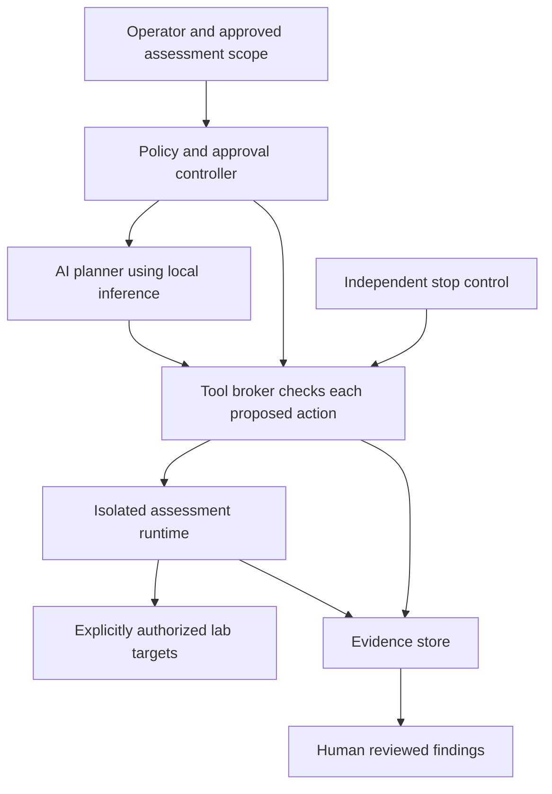

# AEGIS

**Hardware + software + AI for governed security assessment.**

AEGIS explores whether an integrated, locally operated appliance can make authorized security assessment more reproducible, easier to supervise, and less dependent on remote inference services.

**Status: research proposal.** This edition contains an architecture, testable hypotheses, and experiment protocols. It contains no appliance implementation, custom chip design, trained model, or measured AEGIS performance results.

The research question is about the convergence of three layers:

| Layer | Role | What must be demonstrated |
|---|---|---|
| Hardware | Local inference, isolation boundaries, operator controls and device identity | Measured performance, serviceability and control behavior on the actual device |
| Software | Scope enforcement, tool mediation, evidence capture and reproducible workflows | Enforcement outside the model, auditable state transitions and failure recovery |
| AI | Propose actions, interpret evidence and assist reporting | Useful task quality under a fixed evaluation, with calibrated uncertainty and human review |

## Proposed architecture

Every execution path needs an enforcement boundary. A fast model, a container, a signature, or a physical switch alone does not establish that boundary.

[Architecture](docs/ARCHITECTURE.md) · [Research record](RESEARCH.md) · [Experiments](experiments/REGISTER.md) · [Threat model](docs/THREAT-MODEL.md) · [Sources and claim limits](docs/SOURCES.md)

## Start small

Begin with a software reference on existing local hardware, a synthetic target, and a small set of bounded tasks. Measure the time spent in inference, tool execution and human review. Specialized inference silicon is a candidate backend only if those measurements justify its integration and update costs.

The first experiment is a protocol, not a runnable benchmark: [AEGIS-E001](experiments/AEGIS-E001.md). No installation command is provided because there is no implementation to install.

## Research connections

AEGIS belongs primarily to **Agentic Security & Trust**, with a cross-link to **AI & Computing Systems**. It uses the SW30 Research Engine methodology: hypothesis → experiment → evidence → finding → kill / modify / reproduce / promote.

Related independent SW30 projects include [agentic security methodology](https://github.com/sw30labs/agentic-ai-pentesting), [OSCAL Skills Guardrails](https://github.com/sw30labs/oscal-skills-guardrails), [DriftLab](https://github.com/sw30labs/driftlab-dgx), and [TSLIT-DSPy DGX](https://github.com/sw30labs/tslit-dspy-dgx). These are research connections, not completed AEGIS integrations or certifications.

**Build a chapel, not a cathedral—and no preaching.** We optimize for the rate at which ideas become evidence. Failure is a result.

AEGIS is a working research name. This is an independent SW30 Labs proposal; no employer, customer, chip vendor or other organization is represented as a partner or sponsor. See [NOTICE.md](NOTICE.md) for ownership and licensing status.
